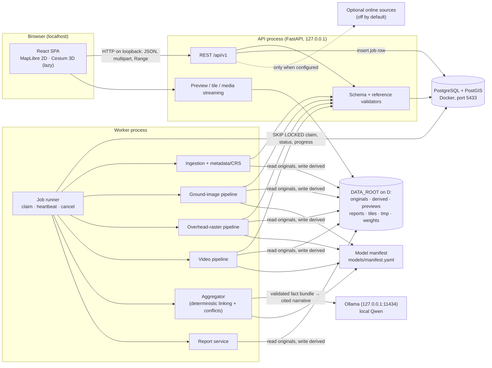
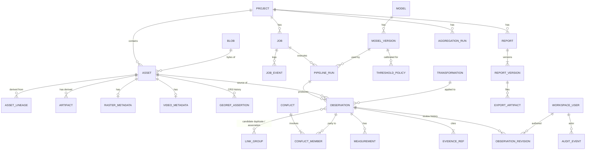
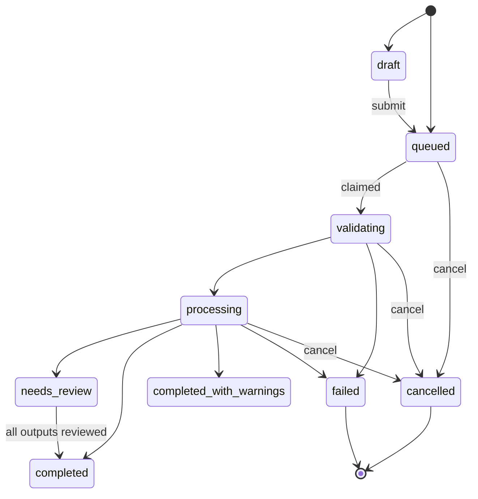

# Implementation Blueprint — Geospatial PoC

Phase 0 planning document. Date: 2026-10-12. Nothing described here has been built.

Companion documents: [decision-log.md](decision-log.md), [environment-assessment.md](environment-assessment.md), [requirements-traceability.md](requirements-traceability.md), [phase-1-readiness.md](phase-1-readiness.md), [../implementation-plan.md](../implementation-plan.md).

**Reading conventions**

- **[SPEC]** — stated in `docs/Geospatial_PoC_UI_and_AI_Analysis_Rules_v3.docx`. "V2 §n" is the Revision 2.0 body; "V3 §n" is the appended Version 3.0 section.
- **[PROPOSED]** — a technical decision made in this blueprint; see the decision log (D-nnn).
- **[OPEN]** — needs approval or missing input (U-nnn, S-nn).
- **[BLOCKED]** — cannot be implemented or tested yet because data, models or definitions are missing.

## 1. Executive summary

The product is a local-first workbench for analysing ground photographs, overhead rasters (including GeoTIFF) and video, each independently. Specialist pipelines emit structured, evidence-linked observations. Validators check them. An aggregator links evidence, flags conflicts and possible duplicates, and a local Qwen model drafts narrative text from validated records only. A human reviews observations; reports are generated from stored records and versioned. The application does not make operational targeting or engagement decisions.

The specification was read in full. It defines 25 numbered rules (R-001 to R-025), 17 named decision rules (ING-001 … OPS-001), 12 tests (T-01 to T-12), a 14-item acceptance checklist, 12 screens, 9 job states and 14 endpoints. It also contains internal inconsistencies (two observation schemas, two review vocabularies) that need a ruling before the schema is built.

The proposed architecture is a modular monolith: a React single-page app, a FastAPI process, one worker process, PostgreSQL + PostGIS, a content-addressed file store, and Ollama as the local LLM runtime. No message broker.

The machine has an RTX 5060 with 8 GB of VRAM and 16 GB of RAM. The installed PyTorch is CPU-only. The system drive has 8.4 GB free. These facts shape the design: GPU work is serialised, rasters are processed in windows, and the project and its data must live on D:.

No vision model and no aggregation model has been selected or validated. That requires sample and labelled data that do not exist yet.

## 2. Requirements and constraints

### 2.1 Product-wide rules [SPEC V2 §2]

1. Any one modality works alone; any combination is allowed.
2. Location / area of interest is optional. A typed project location never proves where an image was captured.
3. Offline core processing uses local files, installed weights, local database/storage and cached map assets.
4. Online imagery discovery is optional, configured, permitted, unavailable offline, and never blocks local upload.
5. Observed evidence, model prediction, derived measurement and human annotation are separated in UI and data.
6. Missing or ambiguous metadata is labelled unknown, not guessed.
7. Every result links to source asset, model/version, run and image region or video timestamp.
8. The LLM may summarise validated records but must not invent coordinates, measurements, detections or sources.
9. Original model output is preserved; human corrections are versioned and audited.

### 2.2 Scope boundary [SPEC V2 §1, V3 §1, OPS-001]

Out of scope and never to be generated: operational target selection or prioritisation, weapon/ammunition matching, engagement timing or planning, desired impact-point selection, strike execution, re-engagement decisions. The procedures in the referenced presentation are not to be encoded as rules. In scope: describing observable features, measuring supported geospatial properties, comparing sources, preserving evidence, surfacing uncertainty, preparing a reviewable report.

### 2.3 Constraints from the environment (verified)

| Constraint | Consequence |
|------------|-------------|
| 8 GB VRAM, about 6.7 GB free with desktop running | One GPU job at a time; unload models between stages |
| 16 GB RAM | Windowed raster reads; streaming video decode; bounded batch sizes |
| C: 8.4 GB free, D: 374 GB free | Project, data root and caches on D: |
| PyTorch installed is CPU-only | CUDA build required in a project venv; unverified until installed |
| No PostgreSQL/PostGIS; port 5432 in use | PostGIS via Docker on 5433 |
| No GDAL/Rasterio/PyProj | Install wheels; verify drivers |
| Long paths disabled | Short project root |

### 2.4 Cannot be implemented or tested yet [BLOCKED]

| Item | Missing input |
|------|---------------|
| Real detection/segmentation in any pipeline | Model selection and weights (U-001) |
| Calibrated thresholds, review policy by class | Labelled validation data (U-004) |
| Any accuracy, precision or recall claim | Labelled validation data |
| DSM coordinate support | Authoritative DSM definition (U-007) |
| Grid-based datum transformations | Decision on grids to bundle (U-006) |
| Measurement/coordinate tolerance assertions beyond library round-trips | Approved tolerances (U-006) |
| Audit of PPT slide references | The PowerPoint is not in the repository (U-016) |
| Online imagery import | Permitted sources not named (U-014) |
| 3D viewing of real data | Supported 3D formats not defined (U-012) |

## 3. Source-derived requirements versus proposed decisions

| Topic | [SPEC] says | [PROPOSED] | [OPEN] |
|-------|-------------|------------|--------|
| Modalities | Three, independent | Three pipeline packages with a shared output contract | — |
| Asset identity | Stable ID, checksum, retain bytes (R-001, ING-001) | SHA-256, content-addressed store, UUID asset IDs | Duplicate policy D-013 |
| Output schema | Two versions (V2 §6, V3 §4) | V3 nested base + V2 extras (D-009) | Approval |
| Review states | Two vocabularies | V3 six states (D-008) | Approval |
| Job lifecycle | Nine states (V2 §9) | Those nine, plus a `cancel_requested` flag | — |
| API | 14 endpoints (V2 §11) | Those 14 + `/scene` + additions marked in §8 | — |
| CRS | Authoritative registry; never guess; DSM unclaimed (V2 §10) | PROJ/EPSG + explicit custom registry (D-011) | U-006, U-007 |
| Aggregator | Qwen consumes structured output, no invention (AGG-001) | Deterministic facts + constrained narrative + validator (D-012) | Model U-002 |
| Reports | Traceable, versioned, zero-findings valid (R-023–R-025) | HTML templates, Chromium PDF (D-014) | Template U-008 |
| Auth | "Credentials if enabled"; undecided (V2 §14) | Local workspace profile (D-018) | U-009 |
| Thresholds | None universal (R-011, CON-002) | No thresholds until calibrated | U-004 |
| Database, queue, storage, runtime | Not specified | PostGIS, DB queue, filesystem, Ollama | D-003, D-004 |

## 4. Architecture



### 4.1 How the parts communicate

| From → To | Mechanism | Notes |
|-----------|-----------|-------|
| Frontend → API | JSON over HTTP on loopback; multipart upload; HTTP Range for video; tile GETs | Generated TypeScript client from OpenAPI |
| API → Database | SQLAlchemy 2 (async), Alembic migrations | API never runs model inference |
| API → Worker | No direct call. API inserts a `job` row; worker polls and claims it | Decouples lifetime; survives restarts |
| Worker → Database | Status, stage, progress, heartbeat, events; results written in one transaction per run | |
| Worker → Pipelines | In-codebase function call executed in a child process | Child exit frees VRAM; kill enables cancel |
| Pipelines → Validator | Every candidate observation passes Pydantic validation and reference checks before insert | Invalid output is stored as a rejected run output with reasons, never dropped silently (V2 §4) |
| Worker/API → File store | Local filesystem paths under `DATA_ROOT` | GDAL and FFmpeg need real paths |
| Aggregator → LLM | HTTP to Ollama on loopback with a JSON-schema-constrained response | Loopback-only host is enforced |
| Frontend → job progress | Polling `GET /jobs/{id}` (TanStack Query, 1–2 s while active) | Server-sent events can be added later if needed |

## 5. Component responsibilities and data flows

Responsibilities and prohibitions follow spec V2 §4.

| Component | Does | Must not |
|-----------|------|----------|
| Asset validation | Format sniffing by content, decode test, size, SHA-256, duplicate lookup | Treat corrupt/unsupported input as valid |
| Metadata/CRS | Dimensions, capture time, raster CRS/bounds/pixel size, EXIF where present | Guess CRS, time, location or units |
| Ground-image pipeline | Findings linked to pixel regions | Emit geographic coordinates without geolocation evidence |
| Overhead pipeline | Tiled/banded processing; masks, features, statistics | Report geographic area without valid scale/CRS |
| Video pipeline | Sampled frames with timestamps; frame analysis | Treat frame detections as certain identity tracking |
| Validator | Required fields, references, ranges, consistency | Silently discard invalid output |
| Aggregator | Link evidence, mark conflicts and possible duplicates, summarise known facts and gaps | Invent facts or decide operational actions |
| Report service | Traceable reports from stored results | Include unsupported LLM numbers or claims |

### 5.1 Main flow

1. **Create/open project.** Optional AOI and CRS are stored as user-entered context only.
2. **Upload.** The API streams the file to `tmp/`, hashing as it goes, checks free disk space, then moves it into `originals/` and creates the `asset` row. A validation job is queued automatically.
3. **Validate.** The worker sniffs the real format, attempts a decode, extracts metadata, records explicit unknowns (R-004), builds a preview, and for rasters a COG derivative. Failures produce a recorded error and no observations (T-01).
4. **Run a compatible pipeline.** The user picks from pipelines compatible with the asset's modality and with models reported available. A `pipeline_run` row records model, version, settings and timestamps (R-008).
5. **Store and validate output.** Observations, evidence references, quality flags and measurements are inserted after validation. Initial review status is assigned by policy (§9.4).
6. **Aggregate.** Deterministic linking and conflict detection, then optional LLM narrative.
7. **Review.** Map, modality viewers and the Observations screen; each action appends a revision.
8. **Report.** A report job renders a new immutable report version.

## 6. Proposed repository structure

[PROPOSED] (D-021). To be created in Phase 1 and later; nothing is created in Phase 0 beyond the planning documents.

```
apps/web/                     React + TypeScript + Vite + Tailwind
  src/app/                    router, layout, providers
  src/features/               one folder per screen (dashboard, projects, ingestion, map, ground,
                              overhead, video, scene3d, observations, reports, settings, workspace)
  src/api/                    generated OpenAPI client (not hand-edited)
  src/components/             shared UI (status chips, evidence drawer, quality flags, empty/error states)
  e2e/                        Playwright specs
services/api/
  geopoc/
    api/                      FastAPI routers, request/response models, error handlers
    domain/                   projects, assets, jobs, observations, review, reports (no framework imports)
    contracts/                Pydantic observation schema, flag registry, state machine
    db/                       SQLAlchemy models, repositories
    jobs/                     queue, worker loop, stage runner, cancellation
    storage/                  content-addressed store, artifact paths, cleanup
    geo/                      CRS registry, transforms, measurement, raster metadata
    ingestion/                sniffing, decode checks, metadata extraction, previews
    aggregation/              linking, conflicts, independence groups, LLM client, output validator
    reporting/                templates, HTML/PDF rendering, export writers
    registry/                 model manifest loader, availability checks
    config.py                 settings (env + file), no secrets in repo
  migrations/                 Alembic
  tests/                      unit + integration for the service
ml/
  geopoc_ml/
    common/                   adapter interface, tiling, device management, stub adapter
    ground_images/            ground-image pipeline
    overhead_imagery/         overhead-raster pipeline
    video/                    frame extraction, frame analysis, optional association
  tests/
models/
  manifest.yaml               model registry source of truth
  cards/                      one short card per model: source, licence, classes, limits
tests/
  acceptance/                 T-01 … T-12 and checklist items, one module each
  contract/                   Schemathesis configuration
  fixtures/                   small synthetic fixtures and generators (no large binaries)
docs/                         specification and architecture documents
infra/
  docker-compose.yml          PostGIS only
scripts/                      PowerShell 5.1-compatible dev scripts
```

`ml/reporting/` from the suggested layout is folded into `services/api/geopoc/aggregation` and `reporting`, because they are service logic that calls an external runtime, not model code. `data/` is replaced by `DATA_ROOT` outside the repository.

The three pipeline packages do not import each other. They share only `geopoc_ml.common` and the contract package.

## 7. Database entity and relationship design

[PROPOSED]. PostgreSQL + PostGIS, SQLAlchemy 2, GeoAlchemy2, Alembic.



### 7.1 Entities

| Entity | Key columns | Notes |
|--------|-------------|-------|
| `workspace_user` | id, display_name, role, password_hash (nullable), created_at | Reviewer identity for audit (D-018) |
| `project` | id, name, description, tags[], aoi_geom (geometry, 4326, nullable), aoi_source_crs, aoi_entered_by, source_preference, created_at, archived_at | AOI is user context, never evidence of capture location |
| `blob` | sha256 (PK), size_bytes, storage_path, created_at | One row per unique byte content |
| `asset` | id, project_id, blob_sha256, original_filename, declared_media_type, detected_media_type, modality (`ground_image`/`overhead_raster`/`video`), status, duplicate_of_asset_id, origin (`upload`/`online_import`/`derived`), source_info (jsonb: source, retrieval time, identifier, licence — R-007), metadata (jsonb), unknowns (jsonb: field → reason), quality_flags[], ingested_at, acquisition_time (nullable) | `unknowns` implements R-004 |
| `asset_lineage` | child_asset_id, parent_asset_id, relation (`converted_from`/`reprojected_from`/`frame_of`/`duplicate_of`), tool, tool_version, parameters (jsonb) | ING-001 conversion lineage; basis for independence groups |
| `artifact` | id, asset_id, kind (`preview`/`cog`/`frame`/`annotated`/`mask`/`tile_cache`), storage_path, sha256, created_by_run_id, valid_for_geo_measurement (bool), created_at | R-002; RAS-001 invalid-derivative flag |
| `raster_metadata` | asset_id, driver, width, height, band_count, dtypes, nodata, crs_authority_code, crs_wkt, crs_status (`valid`/`missing`/`invalid`/`user_asserted`), geotransform (6 floats), pixel_size_x/y, pixel_units, bounds_native, footprint_4326 (geometry) | RAS-001 |
| `video_metadata` | asset_id, container, codec, width, height, duration_ms, avg_frame_rate, time_base, frame_count (nullable), is_vfr (nullable), creation_time (nullable) | VID-001 |
| `georef_assertion` | id, asset_id, crs_identifier, method (`embedded`/`sidecar`/`human_entered`), entered_by, rationale, created_at, superseded_at | Resolution of unknown CRS is a recorded human claim, never silent (R-005) |
| `job` | id, project_id, kind (`validate`/`analyze`/`aggregate`/`report`/`export`), status, stage, progress (nullable), cancel_requested, attempt, max_attempts, payload (jsonb), error_code, error_message, has_partial_outputs, worker_id, heartbeat_at, created_at, started_at, finished_at, retry_of_job_id | V2 §9 |
| `job_event` | id, job_id, at, level, stage, message, data (jsonb) | Log summary shown in UI; redacted |
| `model` / `model_version` | name, task, modality; version, weights_path, weights_sha256, runtime, score_semantics, calibrated (bool), classes[], min_input (jsonb), licence, requirements (jsonb), available (computed) | Mirrors the manifest |
| `threshold_policy` | id, model_version_id, category, task, threshold, calibration_dataset_ref, calibrated_at, approved_by | Unique (model_version, category, task); no fallback row (CON-002) |
| `pipeline_run` | id, job_id, asset_id, pipeline_id, model_version_id, settings (jsonb), status, started_at, finished_at, code_version, library_versions (jsonb), rejected_outputs (jsonb) | R-008 |
| `observation` | id, project_id, asset_id, run_id, pipeline_id, origin (`model`/`human`), category, description, claim_type, score_raw, score_semantics, score_calibrated, detection/classification/geolocation status fields, geom_image (jsonb + convention), geom_geo (geometry, 4326, nullable), geom_source (jsonb: coordinates in source CRS), crs_id, coordinate_units, derivation_method, uncertainty (jsonb), transformation_id, frame_index, timestamp_ms, quality_flags[], summary, raw_output (jsonb, immutable), current_status, current_category, created_at | Raw columns never updated (D-010) |
| `evidence_ref` | id, observation_id, asset_id, region_px (jsonb), raster_window (jsonb), frame_index, timestamp_ms, metadata_key, artifact_id | At least one per observation (EVD-001) |
| `measurement` | id, observation_id, name, value, unit, method, validity (`valid`/`estimated`/`unavailable`), space (`geographic`/`image`) | R-017 |
| `observation_revision` | id, observation_id, revision_no, action (`confirm`/`reject`/`relabel`/`note`/`status_change`/`geometry_edit`), before (jsonb), after (jsonb), status_after, reviewer_id, note, created_at | Append-only (R-018, REV-001) |
| `link_group` / `link_member` | id, kind (`possible_duplicate`/`cross_frame_association`/`same_feature`), method, status (`candidate`/`confirmed`/`rejected`), rationale; observation_id | R-016, R-020; never deletes members |
| `conflict` / `conflict_member` | id, project_id, attribute (`category`/`measurement`/`location`/`timestamp`/`change`), status (`open`/`resolved_documented`), resolution_rule, created_by_run; observation_id, value (jsonb) | CON-001 |
| `transformation` | id, source_crs, target_crs, pipeline_definition, accuracy_m (nullable), grids_used[], proj_version, library_version, created_at | R-006, GEO-001 |
| `crs_definition` | id, identifier, kind (`authority`/`custom`), wkt2, units, axis_order, area_of_use, source_reference, approved_by, status (`active`/`unclaimed`) | Custom entries only with a recorded source |
| `aggregation_run` | id, project_id, job_id, input_snapshot_sha256, llm_model_version_id (nullable), prompt_version, output (jsonb), validation_result (jsonb), fallback_used (bool), created_at | AGG-001 |
| `report` / `report_version` | id, project_id, type, title; version_no, parameters (jsonb), content_snapshot (jsonb), aggregation_run_id, created_by, created_at | R-025: new version each time |
| `export_artifact` | id, report_version_id (nullable), project_id, format, storage_path, sha256, crs_id, units, created_at | R-022 |
| `audit_event` | id, at, actor_id, action, entity_type, entity_id, request_id, details (jsonb) | Append-only |

### 7.2 Indexes

- GiST on `observation.geom_geo`, `raster_metadata.footprint_4326`, `project.aoi_geom`.
- B-tree: `asset(project_id, modality)`, `asset(blob_sha256)`, `observation(project_id, current_status)`, `observation(asset_id)`, `observation(run_id)`, `evidence_ref(observation_id)`, `job(project_id, created_at desc)`, `observation_revision(observation_id, revision_no)` unique.
- Partial: `job(created_at) WHERE status = 'queued'` for claiming.
- GIN on `observation.quality_flags`, `asset.quality_flags`.

### 7.3 Migration strategy

Alembic, linear history, one migration per change, reviewed by hand (autogenerate is a starting point only; PostGIS types need checking). The first migration creates the `postgis` extension. Enumerations are stored as text with check constraints so that adding a value is a simple migration. Every migration is tested up and down against an empty database in CI.

### 7.4 Storage boundaries

The database holds metadata, state, geometry and relationships. Bytes of any size live on the filesystem. The only large JSON kept in the database is `raw_output` and report snapshots.

## 8. API resource catalogue

Common rules [PROPOSED]:

- **Versioning:** `/api/v1` prefix. Breaking changes mean `/api/v2`. `/health*` is unversioned, as in the spec.
- **Request identifiers:** every response carries `X-Request-ID` (accepted from the client if present and well-formed, otherwise generated). It is written to logs and `audit_event`.
- **Errors:** RFC 9457 problem details with extensions: `{ "type", "title", "status", "detail", "code", "request_id", "errors": [{ "field", "message" }] }`. `code` is a stable diagnostic code such as `ASSET_DECODE_FAILED`.
- **Pagination:** cursor-based: `?limit=` (default 50, max 200) and `?cursor=`; responses are `{ "items": [...], "next_cursor": string|null }`. No total counts unless cheap; the UI must not show invented counts.
- **Upload limits:** configurable per modality, enforced while streaming; proposed defaults in §12 pending U-003.
- **Access checks:** in local workspace mode every request is attributed to the active profile; the server binds to loopback. If accounts are enabled, a session is required for everything except `/health`. Paths are never accepted from the client; assets are addressed by ID only.
- **Times:** ISO 8601 UTC.

Origin column: S = listed in spec V2 §11; B = candidate from the Phase 0 brief; P = proposed here.

| # | Endpoint | Origin | Mode | Purpose |
|---|----------|--------|------|---------|
| 1 | `GET /health` | S | sync | Liveness, database, storage, free disk, library versions |
| 2 | `GET /health/models` | S | sync | Per-model availability from the manifest; LLM runtime reachability |
| 3 | `POST /api/v1/projects` | S | sync | Create project |
| 4 | `GET /api/v1/projects` | S | sync | List/search projects |
| 5 | `GET /api/v1/projects/{id}` | P | sync | Read one project with counts derived from stored rows |
| 6 | `PATCH /api/v1/projects/{id}` | P | sync | Edit name, description, tags, AOI |
| 7 | `POST /api/v1/projects/{id}/assets` | S | sync + auto job | Upload/register asset; queues validation |
| 8 | `GET /api/v1/projects/{id}/assets` | P | sync | List assets |
| 9 | `GET /api/v1/assets/{id}` | S | sync | Asset metadata, unknowns, flags, status |
| 10 | `GET /api/v1/assets/{id}/preview` | S | sync | Preview image |
| 11 | `GET /api/v1/assets/{id}/content` | P | sync | Original bytes with Range support (video playback, download) |
| 12 | `GET /api/v1/assets/{id}/tiles/{z}/{x}/{y}` | P | sync | Map tiles for rasters with a valid CRS; image-space tiles via `?space=image` |
| 13 | `POST /api/v1/assets/{id}/georeferencing` | P | sync | Record a human CRS assertion for an asset with unknown CRS |
| 14 | `POST /api/v1/projects/{id}/jobs` | S | job | Submit (or save as draft) a job |
| 15 | `GET /api/v1/projects/{id}/jobs` | P | sync | List jobs |
| 16 | `GET /api/v1/jobs/{id}` | S | sync | State, stage, progress, log summary |
| 17 | `POST /api/v1/jobs/{id}/cancel` | S | sync (request) | Request cancellation |
| 18 | `POST /api/v1/jobs/{id}/retry` | P | job | Safe retry of a failed/cancelled job as a new job |
| 19 | `GET /api/v1/projects/{id}/observations` | S | sync | Query observations |
| 20 | `GET /api/v1/observations/{id}` | P | sync | One observation with raw output, evidence and revision history |
| 21 | `PATCH /api/v1/observations/{id}/review` | S | sync | Save a review action |
| 22 | `GET /api/v1/projects/{id}/conflicts` | P | sync | Conflict records and members |
| 23 | `GET /api/v1/projects/{id}/layers` | S | sync | Map layers that are safe to place |
| 24 | `GET /api/v1/projects/{id}/scene` | B | sync | 3D-compatible layers, possibly empty |
| 25 | `POST /api/v1/projects/{id}/reports` | S | job | Create a report version |
| 26 | `GET /api/v1/projects/{id}/reports` | P | sync | Report list and version history |
| 27 | `GET /api/v1/reports/{id}` | S | sync | Report metadata and download references |
| 28 | `GET /api/v1/reports/{id}/versions/{n}/download` | P | sync | HTML or PDF file |
| 29 | `POST /api/v1/projects/{id}/exports` | P | job | Spatial/tabular export of observations |
| 30 | `GET /api/v1/crs` | P | sync | Offline CRS search in the local registry |
| 31 | `GET /api/v1/models` | P | sync | Model manifest for Settings (version, checksum, semantics) |
| 32 | `GET/PATCH /api/v1/settings` | P | sync | Non-secret configuration; secrets write-only and redacted |

### 8.1 Endpoint contracts

**1. `GET /health`** — Request: none. Response 200: `{ status: "ok"|"degraded", database: {reachable, postgis_version}, storage: {data_root_ok, free_bytes}, worker: {last_heartbeat_at}, versions: {app, gdal, proj, ffmpeg}, online: {enabled: bool} }`. Validation: none. Errors: 503 when the database or storage is unreachable. Access: open on loopback. Sync.

**2. `GET /health/models`** — Response: `{ models: [{ name, version, pipeline_id, runtime, available, reason_unavailable, weights_sha256_ok, device }], llm_runtime: { reachable, model, available } }`. Never loads weights; checks file presence and checksum only. Errors: none beyond 500. Sync.

**3. `POST /api/v1/projects`** — Request: `{ name (1–200), description?, tags?: string[], aoi?: { geometry: GeoJSON Polygon|MultiPolygon|Point, crs_id: string }, source_preference?: "local_only"|"allow_online" }`. Response 201: project. Validation: `aoi` requires `crs_id`; `crs_id` must resolve in the registry; geometry must be valid and within the CRS area of use, otherwise accepted with a warning flag, never altered. Errors: 422 validation, 409 duplicate name (if uniqueness is wanted). Sync.

**4. `GET /api/v1/projects`** — Query: `q?`, `tag?`, `archived?`, `limit`, `cursor`. Response: page of project summaries with counts computed from rows. Sync.

**5–6. `GET`/`PATCH /api/v1/projects/{id}`** — PATCH body: any subset of the create fields. Errors: 404, 422. Changes are audited. Sync.

**7. `POST /api/v1/projects/{id}/assets`** — Request: `multipart/form-data` with `file` and `modality` (`ground_image`|`overhead_raster`|`video`), optional `source_info`. Response 201: `{ asset, duplicate_of_asset_id|null, validation_job_id }`. Validation: size limit while streaming; free-disk check before accepting; filename sanitised and stored only as metadata; content sniffing happens in the validation job. Errors: 404 project, 413 too large, 415 clearly unsupported type, 507 insufficient storage, 422. The upload itself is synchronous; validation is a job.

**8. `GET /api/v1/projects/{id}/assets`** — Query: `modality?`, `status?`, `limit`, `cursor`. Sync.

**9. `GET /api/v1/assets/{id}`** — Response: asset with `metadata`, `unknowns`, `quality_flags`, `raster_metadata|video_metadata`, `lineage`, `compatible_pipelines` (with per-pipeline availability and reason). Errors: 404. Sync.

**10. `GET /api/v1/assets/{id}/preview`** — Query: `size?` from a fixed set. Response: image bytes with `ETag`. Errors: 404 asset; 409 `PREVIEW_NOT_READY`; 422 `ASSET_NOT_DECODABLE`. Sync.

**11. `GET /api/v1/assets/{id}/content`** — Honors `Range`. Response 200/206. Errors: 404, 416. Sync.

**12. `GET /api/v1/assets/{id}/tiles/{z}/{x}/{y}`** — Query: `bands?`, `rescale?`, `space?=geo|image`. Errors: 409 `CRS_UNRESOLVED` when `space=geo` and the raster has no valid CRS; 404 outside bounds. Sync.

**13. `POST /api/v1/assets/{id}/georeferencing`** — Request: `{ crs_id, rationale (required) }`. Response: new `georef_assertion`; the asset gains `CRS_USER_ASSERTED`. Validation: `crs_id` must resolve; raster must have a usable geotransform; the server never proposes a CRS. Errors: 422, 409 if the raster already has a valid embedded CRS. Audited. Sync.

**14. `POST /api/v1/projects/{id}/jobs`** — Request: `{ kind: "analyze"|"aggregate"|"validate", asset_ids?: [], pipeline_id?, model: {name, version}?, settings?: {}, submit: bool (default true) }`. Response 202 (queued) or 201 (draft): job. Validation: assets belong to the project and are validated; pipeline matches each asset's modality; model is available; settings match the model's schema. Errors: 404, 409 `ASSET_NOT_READY`, 409 `MODEL_UNAVAILABLE`, 422 `PIPELINE_INCOMPATIBLE`. Job-based.

**15–16. `GET .../jobs`, `GET /api/v1/jobs/{id}`** — Response: `{ id, kind, status, stage, progress|null, cancel_requested, attempt, error: {code, message}|null, has_partial_outputs, events: last N, run_ids, timestamps }`. `progress` is null when not measurable. Sync.

**17. `POST /api/v1/jobs/{id}/cancel`** — Response 202 with the job. Idempotent. Errors: 404; 409 when already terminal. Sync request; effect is asynchronous.

**18. `POST /api/v1/jobs/{id}/retry`** — Creates a new job with `retry_of_job_id`. Errors: 409 unless the source job is `failed` or `cancelled`. Job-based.

**19. `GET /api/v1/projects/{id}/observations`** — Query: `asset_id?`, `pipeline_id?`, `status?`, `category?`, `flag?`, `has_geo?`, `run_id?`, `bbox?` (requires `bbox_crs`), `limit`, `cursor`. Response: page of observations in the §9 schema with current effective values. Sync.

**20. `GET /api/v1/observations/{id}`** — Response: observation, `raw_output`, `evidence`, `revisions[]`, `conflicts[]`, `links[]`. Sync.

**21. `PATCH /api/v1/observations/{id}/review`** — Request: `{ action: "confirm"|"reject"|"relabel"|"note"|"set_status", status?, category?, note?, expected_revision: int }`. Response: updated observation with new revision. Validation: transition allowed by the state machine (§9.4); `relabel` category in taxonomy; optimistic concurrency via `expected_revision`. Errors: 404, 409 `REVISION_CONFLICT`, 422 `INVALID_TRANSITION`, 403 if the profile's role may not verify (when roles are enabled). Audited. Sync.

**22. `GET /api/v1/projects/{id}/conflicts`** — Query: `status?`, `attribute?`. Sync.

**23. `GET /api/v1/projects/{id}/layers`** — Response: `{ layers: [{ id, kind: "raster"|"observations"|"footprints"|"aoi", title, crs_id, bounds_4326, tile_url|geojson_url, legend, placement: "trusted"|"user_asserted" }], excluded: [{ asset_id, reason: "CRS_UNRESOLVED"|"NOT_GEOREFERENCED" }], basemap: { configured, url|null } }`. Assets without valid georeferencing appear only under `excluded`. Sync.

**24. `GET /api/v1/projects/{id}/scene`** — Response: `{ layers: [...], vertical_datum: string|"unknown" }`. An empty `layers` array is a normal 200 response and drives the 3D empty state. Sync.

**25. `POST /api/v1/projects/{id}/reports`** — Request: `{ report_id?: existing, type, sections: [], filter: { review: "reviewed"|"unreviewed"|"all" }, formats: ["html","pdf"], use_llm_narrative: bool }`. Response 202: `{ job_id, report_id, version_no }`. Validation: project exists; zero observations is allowed. Errors: 404, 422. Job-based. Always creates a new version.

**26–28. Report reads** — `GET /api/v1/reports/{id}`: `{ id, type, versions: [{ version_no, created_at, created_by, status, parameters, files: [{format, url, sha256}] }] }`. Download: file bytes; 404 if the version or format does not exist.

**29. `POST /api/v1/projects/{id}/exports`** — Request: `{ format: "geojson"|"gpkg"|"csv", filter, target_crs_id? }`. Validation: geographic formats include only observations with valid `geom_geo`; pixel geometries are exported only in formats and columns explicitly labelled as image space (checklist item on mislabelled pixels, R-022). Job-based.

**30. `GET /api/v1/crs`** — Query: `q` (code or name), `limit`. Response: `[{ identifier, name, kind, units, axis_order, area_of_use, deprecated }]` from the local PROJ database and the custom registry. Works offline. Sync.

**31–32. `GET /api/v1/models`, `GET/PATCH /api/v1/settings`** — Settings responses never contain secret values; secret fields return `{ set: true|false }`. PATCH is audited. Sync.

Online discovery endpoints are not defined in this blueprint (U-014).

## 9. Observation schema proposal

[PROPOSED] (D-008, D-009), merging V2 §6 and V3 §4. Implemented as strict Pydantic models (`extra="forbid"`). Null means genuinely unknown.

```jsonc
{
  "observation_id": "uuid",
  "project_id": "uuid",
  "asset_id": "uuid",
  "pipeline": "ground_image | overhead_raster | video",
  "origin": "model | human",
  "model": { "name": "...", "version": "...", "run_id": "uuid" },      // required when origin = model
  "claim": {
    "category": "taxonomy id | 'unclassified'",
    "description": "evidence-based text",
    "claim_type": "observed | inferred | metadata_derived | human_entered"
  },
  "stages": {                                                          // DET-001
    "detection":      { "status": "present | absent | not_attempted" },
    "classification": { "status": "assigned | unclassified | not_attempted" },
    "geolocation":    { "status": "established | unavailable | not_attempted", "reason": "code | null" }
  },
  "score": { "raw_value": 0.0, "semantics": "text from model manifest", "calibrated": false,
             "policy": { "threshold": null, "source": "threshold_policy id | null" } },
  "evidence": [
    { "asset_id": "uuid",
      "region_px": { "type": "bbox_xyxy | polygon", "coordinates": [], "coordinate_space": "source_image_pixels",
                     "origin": "top_left", "pixel_reference": "corner | center" } ,
      "raster_window": null, "frame_index": null, "timestamp_ms": null,
      "source_excerpt_or_metadata_key": null }
  ],
  "geospatial": {
    "geometry": null,                     // GeoJSON in crs_id, only with valid georeferencing
    "crs_id": null,                       // complete identifier, e.g. an EPSG code
    "coordinate_units": null,
    "axis_order": null,
    "derivation_method": null,            // e.g. "raster_affine_transform"
    "uncertainty": null,                  // { value, unit } or null
    "transformation_id": null
  },
  "measurements": [
    { "name": "...", "value": null, "unit": null, "method": null,
      "validity": "valid | estimated | unavailable", "space": "geographic | image" }
  ],
  "quality_flags": ["UPPER_SNAKE codes from the registry"],
  "summary": "text grounded in the fields above",
  "review": { "status": "proposed | needs_review | verified | rejected | inconclusive | disputed",
              "reasons": ["flag or policy codes"],
              "reviewer_note": null, "reviewed_by": null, "reviewed_at": null, "revision": 0 },
  "provenance": { "source_checksum": "sha256", "ingested_at": "UTC", "transformations": [],
                  "created_at": "UTC", "code_version": "..." }
}
```

### 9.1 Validation rules

- At least one `evidence` entry whose `asset_id` exists in the same project (EVD-001, R-009). A missing or dangling reference rejects the record; a reference with no region/frame where one is expected marks it `EVIDENCE_INCOMPLETE` and `needs_review`.
- `geospatial.geometry` non-null requires `crs_id`, `coordinate_units`, `derivation_method`, and a source asset whose CRS status is `valid` or `user_asserted` (GEO-001). `user_asserted` adds `CRS_USER_ASSERTED`.
- `pipeline = ground_image` or `video` with non-null geometry is rejected unless `derivation_method` names a supported, configured georeferencing method. None exists in the PoC.
- `score.raw_value` in [0, 1] or null. `calibrated = true` requires a `threshold_policy` row for exactly that model version, category and task (CON-002).
- `measurements[].space = "geographic"` requires valid CRS and pixel size; otherwise the pipeline must emit `space = "image"` in pixels or `validity = "unavailable"` (R-017).
- `frame_index` and `timestamp_ms` are required on video evidence when the container provides them; otherwise null plus `TIMESTAMP_UNKNOWN`.
- Unknown category becomes `unclassified` with flag `UNCLASSIFIED` (V2 §6).

### 9.2 Pipeline-specific extensions

Carried in a typed `extension` object keyed by pipeline, so the common contract stays identical.

| Pipeline | Extension fields |
|----------|------------------|
| `ground_image` | `occlusion_flag`, `relative_size` (fraction of image), `exif_gps_present` (bool; reported as metadata, never promoted to an observation location) |
| `overhead_raster` | `tile_window`, `bands_used`, `mask_artifact_id`, `pixel_count`, `pixel_size_used`, `nodata_fraction` |
| `video` | `extraction` (`interval`, `method`, `ffmpeg_version`), `pts`, `time_base`, `association_group_id`, `association_method`, `association_status = "hypothesis"` |

### 9.3 Quality-flag registry (initial)

From the spec: `UNKNOWN_CRS`/`MISSING_CRS` (one code, `MISSING_CRS`, with `UNKNOWN_CRS` as an accepted input alias), `LOW_CONFIDENCE`, `BLUR`, `METADATA_MISSING`/`METADATA_INCOMPLETE`, `SOURCE_CONFLICT`, `NOT_GEOREFERENCED`, `LOW_RESOLUTION`, `TIMESTAMP_UNKNOWN`.

Proposed additions: `INVALID_CRS`, `CRS_USER_ASSERTED`, `UNCALIBRATED_SCORE`, `UNCLASSIFIED`, `EVIDENCE_INCOMPLETE`, `DUPLICATE_ASSET`, `POSSIBLE_DUPLICATE`, `DERIVATIVE_INVALID_FOR_MEASUREMENT`, `VARIABLE_FRAME_RATE`, `CODEC_WARNING`, `OCCLUDED`, `TINY_FEATURE`, `TRANSFORM_REDUCED_ACCURACY`, `VERTICAL_DATUM_UNKNOWN`, `PARTIAL_OUTPUT`.

### 9.4 Review state machine

Initial status is set by policy, not by the model:

| Condition at creation | Initial status |
|-----------------------|----------------|
| No calibrated threshold for this model/category/task | `needs_review` + `UNCALIBRATED_SCORE` |
| Calibrated threshold exists and score is below it | `needs_review` + `LOW_CONFIDENCE` |
| Any quality flag marked "review-forcing" in the registry | `needs_review` |
| Input cannot support the claim (e.g. unreadable region) | `inconclusive` |
| Member of an open conflict | `disputed` |
| Otherwise | `proposed` |

Until U-004 is answered the first row applies to every model output, so nothing is auto-accepted.

Transitions: `proposed|needs_review|inconclusive|disputed → verified|rejected` by a reviewer; `verified|rejected → needs_review` by a reviewer (reopen); any `→ disputed` by conflict detection; `disputed →` previous or reviewed state only with a documented resolution. `verified` always records who or what verified. No transition deletes anything.

## 10. Job-processing design

[PROPOSED] (D-002). States are exactly those of spec V2 §9.



- **Claiming:** `SELECT ... WHERE status='queued' ORDER BY created_at FOR UPDATE SKIP LOCKED LIMIT 1`, then set `worker_id` and `heartbeat_at`.
- **Concurrency:** one GPU slot; a small CPU pool for validation, previews and reports. A job declares which it needs.
- **Stages and progress:** each job is a list of named stages. Progress is reported only when it is measurable (tiles done / total, frames done / total); otherwise it is null and the UI shows the stage name.
- **Heartbeat and recovery:** the worker updates `heartbeat_at`. On start, and periodically, jobs in a non-terminal running state with a stale heartbeat are requeued if `attempt < max_attempts`, otherwise failed with `WORKER_LOST`.
- **Retries:** automatic retry only for errors classified transient (worker lost, GPU out of memory after reducing batch size, LLM runtime unreachable). Deterministic failures (corrupt file, unsupported codec) are never auto-retried. Manual retry creates a new job (endpoint 18).
- **Idempotency:** a run writes its outputs in one transaction at the end of each asset. A retried job starts a new `pipeline_run`; it never appends to a previous run.
- **Cancellation:** `cancel_requested` is set by the API. The stage runner checks it between units of work and terminates the child process if it does not stop in time. Outputs already committed are kept, the job records `has_partial_outputs`, and affected runs carry `PARTIAL_OUTPUT`. Logs are preserved.
- **Failure:** readable message, stable diagnostic code, redacted detail in `job_event`.
- **Completed with warnings:** any asset skipped or any output rejected by the validator.
- **Needs review:** at least one output in `needs_review`, `disputed` or `inconclusive`.
- **GPU memory:** models are loaded inside the child process; the process exits when the job ends. Before aggregation the worker asks Ollama to load the LLM, and asks it to unload afterwards.

## 11. Asset-storage design

[PROPOSED] (D-004).

```
DATA_ROOT/
  originals/ab/cd/<sha256>            write-once, then read-only; never modified
  derived/<asset_id>/<artifact_id>.*  COGs, converted files, masks, annotated overlays
  previews/<asset_id>/<size>.webp
  frames/<asset_id>/<run_id>/<frame_index>.jpg
  reports/<report_id>/v<n>/report.html|pdf
  exports/<project_id>/<export_id>.*
  tiles/<asset_id>/...                regenerable cache
  basemaps/                           optional offline tile archives
  weights/<model>/<version>/...       model files, checksummed against the manifest
  tmp/uploads/, tmp/jobs/<job_id>/    same volume as originals so the final move is atomic
  logs/
```

- **Upload path:** stream to `tmp/uploads`, compute SHA-256 during the stream, then atomic rename into `originals/`. If the hash already exists the temp file is deleted and the existing blob reused.
- **Originals are never overwritten.** Conversion, reprojection and frame extraction always create new artifacts or derived assets with lineage rows.
- **Large files:** rasters are read in windows; COG derivatives use internal tiling and overviews. Video is decoded as a stream; only sampled frames are written.
- **Cleanup:**

| Class | Policy |
|-------|--------|
| `tmp/uploads` | Deleted on completion; orphans older than 24 h removed at worker start |
| `tmp/jobs/<id>` | Deleted when the job reaches a terminal state |
| `tiles/` | Size-capped cache, least-recently-used eviction |
| `previews/`, COG derivatives | Kept; regenerable on demand |
| `frames/` | Frames cited by an observation are kept; uncited frames from a run are removed after the run commits (configurable) |
| `reports/`, `exports/` | Kept; versions are never deleted automatically |
| `originals/` | Deleted only by explicit project deletion, and only when no other asset references the blob |

- **Disk guard:** uploads and jobs check free space against a configurable reserve and fail early with `INSUFFICIENT_STORAGE`; the Ingestion screen shows the warning the spec asks for.
- **Retention policy** is undecided (U-009).

## 12. Ingestion limits and formats

[OPEN] U-003. Proposed starting defaults, all configurable, to be confirmed against the hardware:

| Modality | Formats to attempt | Proposed size limit |
|----------|--------------------|---------------------|
| Ground image | JPEG, PNG, TIFF | 200 MB |
| Overhead raster | GeoTIFF, TIFF; JPEG 2000 and NITF only if the installed GDAL build reads them (E-05) | 4 GB |
| Video | Containers/codecs the installed FFmpeg decodes; MP4/MOV with H.264/H.265 as the tested baseline | 4 GB |

Acceptance is by content sniffing and a real decode attempt, not by extension (R-003).

## 13. CRS strategy

[SPEC] V2 §10, R-004–R-006, R-017, R-022, GEO-001, GEO-002, RAS-001. [PROPOSED] D-011.

1. **Identity.** A CRS is identified by an authority code that the local PROJ database resolves, or by a complete WKT2/PROJJSON definition held in `crs_definition` with a recorded source and approver. Names, datum names or projection-method names alone are rejected. "WGS84 + LCC" is rejected with an explanation: it names a datum and a projection method but not the projection parameters.
2. **Geographic vs projected.** Both are supported through PROJ. Units come from the CRS definition and are stored with every coordinate set. Angular and linear units are never mixed in a measurement.
3. **Axis order.** Internally every coordinate array is (x, y) = (easting or longitude, northing or latitude), using PROJ's traditional-GIS-order option. The authority-defined axis order is stored in `crs_definition.axis_order` and used when displaying or exporting in formats that require it. GeoJSON output is longitude, latitude as its standard requires.
4. **Raster affine transforms.** The six-parameter geotransform is stored verbatim. Pixel-to-world conversion states the pixel reference (corner vs centre). Rotated or sheared transforms are supported by using the full affine, never an assumed north-up grid. A geotransform equal to the identity, or absent, means not georeferenced.
5. **Missing or invalid georeferencing.** Status is one of `valid`, `missing`, `invalid`, `user_asserted`. For `missing` or `invalid`: image-space viewing works; `geospatial.geometry` stays null; map placement, geographic measurement and coordinate export are disabled with a visible reason. The system never proposes a CRS, UTM zone or transformation.
6. **Resolution by a human.** A user may assert a CRS for an asset (endpoint 13) with a mandatory rationale. Results derived from it carry `CRS_USER_ASSERTED` permanently and layers are labelled `user_asserted`, not `trusted`.
7. **Transformations.** Performed with PyProj. Each distinct transformation is stored once: source, target, the exact PROJ pipeline string chosen, PROJ and PyProj versions, reported accuracy and grids used. If the best transformation needs a grid that is not installed, the fallback is used only with `TRANSFORM_REDUCED_ACCURACY`, or refused if no fallback exists. PROJ network access is off.
8. **Storage.** `geom_source` keeps coordinates exactly as derived in the source CRS. `geom_geo` holds a PostGIS geometry in EPSG:4326 for indexing and map display. Both are linked to the transformation record. Measurements are computed from the source CRS when it is projected and suitable, or geodesically on the ellipsoid; the method is recorded.
9. **Geometry validity.** Checked before insert. Invalid geometry is rejected or stored with the repair method recorded as a transformation; it is never repaired silently.
10. **Map rendering.** MapLibre renders in Web Mercator. The backend supplies layers in EPSG:4326/tiles in Web Mercator for display only. The coordinate readout shows the position in a user-selected registered CRS with its identifier and units always visible. Display formats such as DMS are generated by deterministic conversion from the stored numeric value (GEO-002).
11. **Raster bounds and alignment.** Footprints are computed by transforming the densified raster outline, not just four corners. Overlays between rasters are offered only when both have valid CRSs.
12. **AOI.** Optional. Stored with the CRS the user declared. It filters and frames the map; it is never used to position an ungeoreferenced asset and never proves capture location.
13. **Vertical.** Heights are stored only with a stated vertical reference; otherwise `VERTICAL_DATUM_UNKNOWN` and the 3D screen labels it.
14. **DSM.** [BLOCKED] No Defence Series Map definition is assumed, approximated or shipped. The registry can hold a `crs_definition` row with status `unclaimed` and no parameters so that the UI states the position accurately. Support requires an authoritative definition and a separate review (U-007).

Geospatial correctness tests (proposed): round-trip of known control points between registered CRSs within a stated numerical tolerance; pixel-to-world and back for north-up and rotated synthetic rasters; a missing-CRS raster yields null geometry; a conversion that drops the CRS is marked invalid for measurement; axis-order regression test with a CRS whose authority order is latitude-first.

## 14. AI pipeline boundaries

Common to all three [PROPOSED]:

- A pipeline receives an asset ID, a model version and settings, and returns candidate observations in the common schema. It does not write to the database directly; the stage runner validates and persists.
- Decode and quality checks run before inference (IMG-001). The blur indicator is stored as a raw measured value with its method. No pass/fail threshold is applied until one is validated (U-005).
- Models are reached only through the adapter interface. Model identity, weights checksum and score semantics come from the manifest.
- No pipeline assigns `verified`. No pipeline applies a threshold that is not in `threshold_policy` for that exact model version and category.

| Pipeline | In scope | Explicitly not done |
|----------|----------|---------------------|
| Ground image [SPEC V3 §6.1] | Decode/quality checks; detections with pixel regions; flags for occluded, tiny, blurred or ambiguous features; visible appearance described as `observed`, anything about identity, purpose or ownership as `inferred` or omitted | Map coordinates; EXIF GPS promoted to an observation location |
| Overhead raster [SPEC V3 §6.2] | CRS/geotransform/bands/nodata/pixel-size reading; tiled inference; masks, features, per-class pixel statistics; geographic geometry and area only with valid CRS and pixel size | Real-world size from pixels without a valid scale; any CRS guess |
| Video [SPEC V3 §6.3] | Frame extraction at a recorded interval; frame index and presentation timestamp from the container; frame-level detections; optional association stored as a hypothesis in a link group | Counting adjacent-frame detections as independent when association is on; treating track identity as fact; any location without camera pose/calibration/geospatial metadata |

**Video reproducibility (VID-001).** Frame references are defined as (source checksum, extraction settings, frame index, presentation timestamp, time base). Extraction uses fixed, recorded FFmpeg options. Variable-frame-rate sources are flagged. The tolerance for T-05's "within documented tolerance" will be documented from measurements on fixtures.

**Model selection [OPEN/BLOCKED] (U-001).** No model is chosen in this phase. Selection criteria to apply when sample data exists: fits about 6 GB VRAM on this GPU with headroom; licence compatible with the project's intended use (some popular detection frameworks carry copyleft licences); weights obtainable for offline installation; classes relevant to the taxonomy; measurable on a labelled validation set. Until then the stub adapter (D-017) is the only implementation.

### 14.1 Model manifest

`models/manifest.yaml` is the single source for the registry tables.

```yaml
- name: example-detector            # illustrative entry only
  version: "0.0.0"
  pipeline: ground_image
  task: detection
  runtime: pytorch | onnxruntime | ollama | stub
  weights: { path: weights/example-detector/0.0.0/model.bin, sha256: "<hex>" }
  classes_ref: cards/example-detector.md
  score: { semantics: "<what the number means for this model>", calibrated: false }
  min_input: { width: null, height: null }      # unknown until validated
  requirements: { device: cuda|cpu, vram_mb_estimate: null }
  licence: "<identifier>"
  locality: local                               # 'remote' entries are refused by the loader
```

Availability = file present, checksum matches, runtime importable, device requirement met. `/health/models` reports the reason when any check fails.

## 15. Local Qwen aggregation contract

[SPEC] AGG-001, R-019–R-021, V3 §6.4, T-09. [PROPOSED] D-007, D-012.

### 15.1 Steps

1. **Select** validated observations for the project (optionally filtered by review state).
2. **Group deterministically:** candidate "same feature" groups by spatial overlap where geometry is valid, by asset and region otherwise; video association groups as supplied.
3. **Independence:** compute independence groups from blob identity and lineage roots. `independent_source_count` counts groups, not files (SRC-002, T-06). Independence beyond that needs supporting metadata or a documented review.
4. **Corroboration:** recorded only with source links and a rationale (R-014).
5. **Conflicts:** for each group, compare category, measurements, location and timestamps across sources. Disagreement creates a `conflict` with every differing value and sets members to `disputed` unless a documented deterministic rule resolves it (CON-001). Values are never averaged.
6. **Build the fact bundle:** a JSON document of facts, each with an ID.
7. **LLM narrative (optional):** Qwen receives the fact bundle and a fixed system prompt. It returns JSON matching the output schema.
8. **Validate, retry, or fall back.**
9. **Persist** as an `aggregation_run` with the bundle hash, model version, prompt version, raw output and validation result.

### 15.2 Input (fact bundle)

```jsonc
{ "bundle_id": "sha256", "project_id": "uuid",
  "assets":       [{ "asset_id", "modality", "unknowns": ["..."], "quality_flags": [] }],
  "observations": [{ "observation_id", "asset_id", "category", "claim_type", "review_status",
                     "score": { "raw_value", "calibrated" }, "has_geometry": false,
                     "measurements": [], "quality_flags": [] }],
  "groups":       [{ "group_id", "observation_ids": [], "independent_source_count": 1 }],
  "conflicts":    [{ "conflict_id", "attribute", "members": [{ "observation_id", "value" }] }],
  "gaps":         [{ "code": "MISSING_CRS", "asset_ids": [] }] }
```

### 15.3 Output schema

```jsonc
{ "bundle_id": "must equal input",
  "statements": [
    { "text": "one factual sentence",
      "basis": "observed | inferred | human_annotation | unknown",      // R-021
      "cites": { "observation_ids": [], "asset_ids": [], "conflict_ids": [] } }  // at least one ID
  ],
  "conflict_notes": [{ "conflict_id": "...", "text": "..." }],
  "limitations":    [{ "text": "...", "gap_codes": [] }],
  "unknowns":       [{ "question": "...", "reason": "not available in validated data" }] }
```

The schema has no fields for coordinates, measurements, counts, confidence values or new detections.

### 15.4 Output validation

A response is accepted only if: it parses against the schema; `bundle_id` matches; every cited ID exists in the bundle; every statement cites at least one ID; every numeric token, coordinate-like pattern, date/time and unit expression in any text appears in a cited fact; every conflict in the bundle is mentioned; no deny-listed operational content (D-020). Rejections are stored with reasons. After a bounded number of retries the service uses a deterministic template and records `fallback_used`.

### 15.5 Runtime behaviour

- The LLM host must be a loopback address. Cloud-routed model tags are refused.
- Low temperature and a fixed seed where the runtime supports them. Output is still treated as non-deterministic and is always validated.
- Bundles larger than the model's context are split by group; counts and totals are never requested from the LLM.
- If the runtime or model is unavailable, aggregation steps 1–6 still run and reports are produced without narrative, with a visible notice.
- The aggregator has no tool access, no file access and no network access.

**Model choice [OPEN] (U-002).** A 23 GB Qwen build and a 6 GB Qwen vision-language build are present in Ollama. Neither has been run. The 23 GB model exceeds VRAM and system memory headroom on this machine. A model must be chosen by measuring schema adherence on T-09-style fixtures, VRAM and speed.

## 16. Local-first and offline architecture

[SPEC] V2 §2, §10; checklist: offline upload, inference, review and report generation with the network disabled.

| Capability | Offline | Depends on |
|------------|---------|------------|
| Workspace, projects, dashboard | Yes | Local database |
| Upload, validation, metadata, previews | Yes | Local libraries |
| Analysis pipelines | Yes | Weights installed beforehand |
| CRS search and transformations | Yes | Bundled PROJ database; grids only if installed |
| Map with local layers | Yes | Nothing external |
| Basemap | Only if an offline tile archive is installed | U-013 |
| Aggregation narrative | Yes | Ollama running, model pulled beforehand |
| Review, audit | Yes | — |
| Reports, HTML/PDF | Yes | Local Chromium installed beforehand; fonts and scripts bundled, no CDN |
| 3D view | Yes for supported local data | No Cesium ion; no default online imagery/terrain |
| Online imagery discovery | No | Configured, permitted source (U-014) |
| Place-name search / geocoding | No | External service, off by default |
| Model download | No | Done at install time only |

Controls [PROPOSED] (D-016):

- All frontend assets, fonts, map styles, glyphs and sprites are served locally.
- Backend: Hugging Face offline mode, PROJ network off, no telemetry, LLM host restricted to loopback.
- Online integrations are entries in Settings, disabled until configured. Each call records source, retrieval time, identifier and licence metadata (R-007). User imagery is never sent to an external service by any code path in the PoC.
- A single `online_enabled` switch is reported by `/health` and shown in the UI header.

UI states:

| Situation | State shown |
|-----------|-------------|
| Model weights missing or checksum mismatch | Pipeline listed as unavailable with the reason and the manifest path; Run disabled; other modalities unaffected |
| LLM runtime unreachable | "Narrative unavailable"; deterministic report still offered |
| Network disabled | Online source and place-search controls disabled with an "offline" label |
| No basemap or tile failure | Neutral background with graticule; local layers still render; non-blocking notice |
| Asset without CRS | Listed under "Not placed on map" with reason; link to image-space viewer |
| Incomplete dataset (e.g. no compatible 3D data) | Empty state explaining what data would enable the view |
| Database or worker down | Blocking banner with diagnostic code from `/health` |

## 17. UI screen map

Routes are those of spec V2 §8. Navigation: persistent project sidebar (Map, Assets, Observations, Reports, 3D) inside a project; global header with workspace, online/offline indicator, job tray and Settings. Main journey: Workspace → Dashboard → Create/Open Project → optional Location/CRS → Upload → Validate → Select compatible pipeline → Run → Validate results → Review evidence → Map → Report. A user with one modality never sees a prompt for the others; pipelines for absent modalities simply have nothing to select.

Test labels: T-nn are spec IDs. CL-nn are the spec's 14 unnumbered checklist items, numbered in this project's documents in their original order (see the traceability matrix); they are not source identifiers.

| # | Screen / route | Requirements | API | Entities | Loading | Empty | Error | Tests |
|---|----------------|--------------|-----|----------|---------|-------|-------|-------|
| 1 | Login / Local Workspace `/login` | V2 Screen 1; CL-14 | 1, 2 | workspace_user | Health check spinner | First run: create local profile | API unreachable; credential error; offline limitations explained | CL-14 |
| 2 | Dashboard `/dashboard`, `/projects` | V2 Screen 2 | 4, 15 | project, job | Skeleton cards | First-use empty state with "Create project" | Failed-job details with code and retry | CL-01 |
| 3 | New Project & Location `/projects/new` | V2 Screen 3; product rule 2; GEO-001 | 3, 30 | project, crs_definition | CRS search pending | No location entered (valid) | Unknown CRS rejected; place search disabled offline | CL-01 |
| 4 | Data Upload & Ingestion `/projects/:id/assets/new` | V2 Screen 4; R-001–R-005; ING-001; IMG-001; RAS-001 | 7, 8, 9, 10, 14, 16 | asset, blob, artifact, raster/video_metadata, job | Per-file upload and validation progress | Empty queue with accepted formats | Unsupported/corrupt file; unknown CRS; disk space; decoder warning | T-01, T-02, T-03, T-04, T-06, CL-04 |
| 5 | Map & Analysis `/projects/:id/map` | V2 Screen 5; R-005; R-006; GEO-001/002 | 23, 12, 19, 16 | observation, raster_metadata, transformation | Layer loading indicators | No placeable layers: explains why and lists excluded assets | Basemap failure does not block local layers; tile errors per layer | T-03, CL-13 |
| 6 | Ground Image Analysis `.../assets/:assetId/ground` | V2 Screen 6; V3 §6.1; DET-001; R-012 | 9, 10, 11, 19, 20, 21, 14 | observation, evidence_ref, observation_revision | Image and detections loading | Not analysed yet: Run action; analysed with zero findings: stated plainly | Model unavailable; decode failure | T-02, T-08, T-11, CL-01, CL-06 |
| 7 | Satellite/Aerial Analysis `.../overhead` | V2 Screen 7; V3 §6.2; R-017; RAS-001 | 9, 12, 19, 20, 21, 29 | raster_metadata, observation, measurement, artifact | Tile loading | No overlays yet | Unknown CRS blocks trusted placement; area unavailable without valid scale/CRS | T-03, T-04, CL-02, CL-13 |
| 8 | Video Analysis `.../video` | V2 Screen 8; V3 §6.3; R-016; VID-001 | 9, 11, 19, 20, 21, 14 | video_metadata, observation, link_group | Buffering; timeline loading | No sampled frames yet | Codec/time warnings; unsupported codec | T-05, CL-03 |
| 9 | 3D View `/projects/:id/3d` | V2 Screen 9 | 24 | artifact, asset | Scene loading (Cesium loaded on demand) | **Clear empty state without compatible data** | WebGL unavailable; unknown vertical datum labelled | CL-12 |
| 10 | Observations `/projects/:id/observations` | V2 Screen 10; R-013; R-018; R-020; CON-001; REV-001 | 19, 20, 21, 22, 29 | observation, observation_revision, conflict, link_group, audit_event | Table skeleton | No observations: links to ingestion/analysis | Revision conflict on save; invalid transition | T-07, T-11, CL-05, CL-07, CL-09 |
| 11 | Reports `/projects/:id/reports` | V2 Screen 11; R-021–R-025; REP-001 | 25, 26, 27, 28, 16 | report, report_version, aggregation_run, export_artifact | Report job progress | No reports yet; zero-findings report allowed | Report job failed; narrative unavailable | T-09, T-10, T-12, CL-08, CL-10 |
| 12 | Settings `/settings/:tab` | V2 Screen 12; V2 §10 | 1, 2, 30, 31, 32 | model, model_version, crs_definition, threshold_policy | Diagnostics running | No models installed; no online sources configured | Checksum mismatch; secrets never shown; states "WGS84 + LCC alone does not define DSM CRS" | CL-14, T-08 |

Cross-cutting UI rules: every observation shows evidence, source, model/version, quality flags, score semantics and review status (V3 §9 step 7). Observed evidence, model prediction, derived measurement and human annotation use distinct labels and styling (product rule 5). Counts are always computed from stored rows.

## 18. Windows development environment

Verified facts are in [environment-assessment.md](environment-assessment.md). Proposed setup:

| Concern | Proposal |
|---------|----------|
| Location | Short path on D: for the repository; separate `DATA_ROOT` on D: |
| Python | uv-managed `.venv`, Python 3.11, `uv.lock` committed |
| Node | Installed Node 24 + pnpm 10, `pnpm-lock.yaml` committed |
| Database | `postgis/postgis` in Docker Compose, host port 5433, named volume |
| GDAL/PROJ | Rasterio and PyProj wheels; versions and drivers reported by `/health` |
| GPU | CUDA build of PyTorch from the official wheel index, installed in the venv at Phase 3 and verified on the device |
| FFmpeg | Installed 9.0.1 build on PATH; version recorded per run |
| LLM | Installed Ollama; model per manifest |
| Processes | `scripts/dev.ps1` starts database, API, worker and Vite; all bound to loopback |
| Configuration | `.env` (git-ignored) + `.env.example` without values |
| Caches | uv, pnpm and Playwright caches redirected to D: |

## 19. Security and operational risks

| ID | Risk | Mitigation |
|----|------|------------|
| K-01 | Scope creep into operational targeting | OPS-001 controls (D-020); T-12 as a permanent gate; any ambiguous requirement is escalated, not implemented |
| K-02 | LLM invents facts | D-012 validator and deterministic fallback; T-09 |
| K-03 | Imagery leaves the machine through a cloud-routed model tag or online service | Loopback-only LLM host; manifest `locality` check; online off by default; network-blocked test run |
| K-04 | Malicious or malformed media exploiting decoders | Decode in a child process with timeouts and memory caps; pixel/duration limits; keep GDAL, FFmpeg, OpenCV and Pillow current |
| K-05 | Path traversal or overwrite via filenames | Server-generated storage paths; filenames kept only as metadata; write-once originals |
| K-06 | Secrets in logs or settings | Secret fields write-only; log redaction filter; test CL-14 scans logs and API responses |
| K-07 | No real access control in local mode | Loopback binding; documented limitation; accounts optional (D-018) |
| K-08 | Wrong coordinates presented as trustworthy | CRS strategy §13; `trusted` vs `user_asserted` labelling; geospatial tests |
| K-09 | Unvalidated model treated as reliable | Everything `needs_review` until calibrated; score semantics always shown; no accuracy claims |
| K-10 | Disk exhaustion | Disk guard, D: data root, cache caps |
| K-11 | GPU out of memory or contention with desktop apps | Single GPU slot; child-process isolation; batch back-off |
| K-12 | Job lost on crash or reboot | Database queue with heartbeat recovery |
| K-13 | Model or library licence incompatible with intended use | Licence recorded per model card; reviewed at selection (U-001) |
| K-14 | Loss of local data | Documented backup of database dump + `DATA_ROOT`; not automated in the PoC |
| K-15 | Reviewer over-trusts unaudited PPT slide references | References marked not verified until the deck is supplied (U-016) |
| K-16 | Browser-side injection through metadata (EXIF text, filenames) rendered in UI or reports | Escape all metadata; templates auto-escape; no HTML from the LLM |

## 20. Acceptance criteria

The release gate is the spec's own catalogue: T-01 to T-12 (V3 §7) and the 14 checklist items (V2 §12), each automated where possible and mapped to a phase in [../implementation-plan.md](../implementation-plan.md) and [requirements-traceability.md](requirements-traceability.md). They are not replaced by generic tests.

Blueprint-level criteria [PROPOSED]:

1. Each modality can be ingested, analysed, reviewed and reported with no other modality present.
2. No code path produces a geographic coordinate for an asset whose CRS status is `missing` or `invalid`.
3. Every observation row has at least one resolvable evidence reference and a run with model, version, settings and timestamps.
4. Raw model output is retrievable for every reviewed observation.
5. Every report version is immutable and lists assets, methods, model versions, settings, timestamps, warnings, review status and limitations.
6. With external network access blocked, the core flow completes and no outbound connection is attempted.
7. No response, log line or settings view contains a secret value.
8. The T-12 prompt set yields refusals with an evidence-only alternative.

Passing these with the stub adapter demonstrates the contracts and controls. It does not demonstrate model quality, which stays unvalidated until U-001 and U-004 are resolved.
