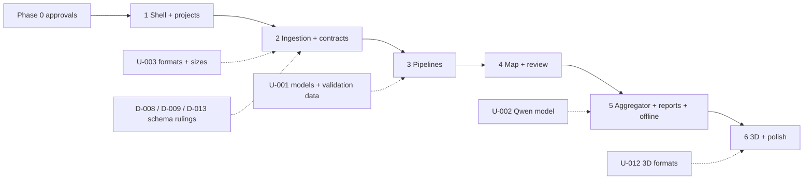

# Implementation Plan — Geospatial PoC

Phase 0 planning document. Date: 2026-10-12. No phase after Phase 0 has started.

References: [architecture/implementation-blueprint.md](architecture/implementation-blueprint.md), [architecture/decision-log.md](architecture/decision-log.md), [architecture/requirements-traceability.md](architecture/requirements-traceability.md), [architecture/phase-1-readiness.md](architecture/phase-1-readiness.md).

## 1. How the phases were derived

The phase numbers and exit criteria are those of the specification (V2 §13). The specification's later "Implementation order" (V3 §9) asks for ingestion, identifiers, checksums, provenance and the output schema before pipelines and the aggregator. The two are reconciled by placing those foundations at the start of Phases 1 and 2, so both orderings hold:

| V3 §9 step | Lands in |
|------------|----------|
| 1. Ingestion, stable asset IDs, checksums, metadata extraction, provenance | Phase 2 |
| 2. Output schema and validation/state transitions before the aggregator | Phase 2 (contract), Phase 3 (enforced on pipeline output) |
| 3. Connect each specialist pipeline; evidence references required | Phase 3 |
| 4. Coordinate/raster validation and reproducible video frame references | Phases 2–3 |
| 5. Qwen aggregation with schema validation and no-invention tests | Phase 5 |
| 6. Run the acceptance suite and calibrate thresholds on labelled data | Phase 5 gate; calibration blocked on data |
| 7. UI exposes evidence, source, model/version, flags, score semantics, review status | Phase 4 |

Test identifiers: **T-nn** are the specification's (V3 §7). **CL-nn** number the specification's 14 unnumbered checklist items (V2 §12) in their original order; the numbering is this project's, not the source's. **PT-nn** are additional tests proposed here.

## 2. Phases

### Phase 1 — Foundation, app shell, navigation, Dashboard, project wizard

**Spec exit criterion:** create and reopen a project.

**Scope**
- Repository initialisation, tooling, lockfiles, lint/format, test runners, dev scripts.
- Docker Compose with PostGIS; first Alembic migrations (`workspace_user`, `project`, `audit_event`, `crs_definition`).
- FastAPI skeleton: error format, request IDs, `/health`, `/health/models` (reports an empty manifest truthfully), project endpoints, CRS search.
- React shell: routes from spec V2 §8, layout, Login/Local Workspace, Dashboard, New Project & Location (name, description, tags, optional AOI with CRS search), Settings shell with diagnostics.
- Generated TypeScript client from OpenAPI.

**Exclusions:** uploads, jobs, any pipeline, map layers beyond showing an optional AOI, models, reports, 3D.

**Dependencies:** approvals B-1 to B-4 in the readiness checklist.

**Deliverables**
- Running API + web app + database started by one script.
- Projects can be created without a location, listed, searched, reopened, edited.
- CRS search working offline from the local PROJ database (requires PyProj in this phase).
- CI-style local command that runs lint, type-check and all tests.

**Tests**
- CL-01 (first half): create a project without location.
- CL-14 (partial): settings and logs contain no secret values.
- PT-01: API contract tests generated from OpenAPI for all Phase 1 endpoints.
- PT-02: migrations apply and roll back on an empty database.
- PT-03: project creation rejects an incomplete CRS string such as "WGS84 + LCC" and accepts a resolvable authority code.
- PT-04: end-to-end browser test: profile → dashboard empty state → create project → reopen.
- PT-05: `/health` reports degraded/unavailable correctly when the database is stopped.

**Completion gate:** spec exit criterion met; all listed tests pass; no skipped tests without a recorded reason.

**Effort:** 5–8 working days.

### Phase 2 — Ingestion, validation, metadata, previews, contracts

**Spec exit criterion:** single-modality ingestion works for all input types.

**Scope**
- Content-addressed storage, streaming upload, SHA-256, duplicate policy, lineage.
- Job queue and worker (claim, heartbeat, stages, cancel, retry) with the `validate` job kind.
- Content sniffing and decode checks for images, rasters and video; metadata extraction; explicit unknowns.
- Raster metadata and CRS status; COG derivative with RAS-001 verification; video metadata via ffprobe.
- Previews; image-space and georeferenced tile endpoints.
- The observation contract package: Pydantic schema, quality-flag registry, review state machine, validators — tested with hand-built records, no models.
- Data Upload & Ingestion screen with all three tabs, queue, metadata, preview, checksum, warnings.

**Exclusions:** inference, observations from models, map screen, aggregation, reports.

**Dependencies:** Phase 1. Decisions D-008, D-009, D-013 approved. U-003 answered or defaults accepted.

**Deliverables**
- Each modality ingests alone; corrupt and unsupported inputs produce recorded, actionable errors.
- Assets expose metadata, unknowns and flags through the API.
- Contract package with full unit coverage of validation rules and state transitions.

**Tests**
- T-01: corrupt image → ingestion fails safely, error recorded, no observation.
- T-02 (ingestion half): blurred/low-resolution image → quality indicator and flag recorded.
- T-03 (ingestion half): raster with missing CRS → preview works, CRS status `missing`, flagged.
- T-04: valid GeoTIFF → CRS, geotransform, pixel metadata retained.
- T-06 (lineage half): duplicate files detected and linked deterministically.
- CL-04: corrupt/unsupported files give actionable errors without breaking the project.
- Rule tests from the spec text: ING-001 (same file twice; conversion creates a linked derived asset), IMG-001 (clear, blurred, corrupt, tiny), GEO-001 (known CRS, missing CRS, invalid metadata), RAS-001 (convert a fixture and compare CRS, geotransform, dimensions, pixel values), EVD-001 (invalidate an evidence reference → rejected or flagged).
- PT-06: job lifecycle — queue, cancel while queued, cancel while running, worker-lost recovery, retry creates a new job.
- PT-07: upload larger than the limit and upload with insufficient disk fail with the documented codes.
- PT-08: originals are byte-identical after every operation (hash before/after).
- PT-09: extension spoofing (e.g. text file named `.tif`) is rejected by content.
- PT-10: pixel-to-world round trip on north-up and rotated synthetic rasters.

**Completion gate:** spec exit criterion met for all three modalities; listed tests pass; GDAL driver list recorded.

**Effort:** 9–14 working days.

### Phase 3 — Ground, overhead and video pipelines and analysis jobs

**Spec exit criterion:** each pipeline independently returns structured results.

**Scope**
- Adapter interface, device management, stub adapter.
- `analyze` job kind; pipeline runs with full provenance.
- Ground-image, overhead-raster and video pipelines to the boundaries in blueprint §14.
- Video frame extraction with reproducible references.
- Geographic geometry and measurements for overhead output only when CRS and pixel size are valid.
- Score semantics, uncalibrated labelling, per-model threshold policy table.
- CUDA PyTorch installed and verified on the GPU.
- Real model adapters **only for models approved under U-001**.

**Exclusions:** aggregation across assets, conflict records, report generation, review UI.

**Dependencies:** Phase 2. U-001 for real models (not for the plumbing). U-005, U-010, U-011, U-015 or their defaults.

**Deliverables**
- Three independently runnable pipelines producing validated observations.
- Model manifest and `/health/models` reflecting actual availability.
- Recorded GPU verification and per-model VRAM/latency measurements for any real model.

**Tests**
- T-02 (inference half): no classification on a blurred image is marked verified.
- T-03 (measurement half): geospatial measurements withheld or qualified for missing-CRS raster.
- T-04 (transformation half): transformations logged.
- T-05: video observation links to source video, frame index, timestamp.
- T-08: uncalibrated score → semantics disclosed, no probability claim.
- CL-01, CL-02, CL-03: each modality analysed independently.
- CL-05: every result has source, pipeline/model/run provenance and evidence references.
- CL-06: low-confidence outputs follow the configured policy and are never silently confirmed.
- Rule tests: DET-001 (visible object, no georeferencing → region only, no coordinates), CON-002 (an unconfigured model cannot inherit another model's threshold), VID-001 (re-extraction with fixed settings reproduces frame references within the documented tolerance).
- PT-11: pipelines do not import one another (import-graph check).
- PT-12: invalid pipeline output is recorded as rejected with reasons, not dropped.
- PT-13: cancelling an analysis job preserves logs and flags partial outputs.
- PT-14: GPU smoke test (skipped with a recorded reason when no CUDA build is present).

**Completion gate:** spec exit criterion met. If U-001 is still open, the gate is met with the stub adapter and the phase report states explicitly that no real model has been integrated or evaluated.

**Effort:** 12–20 working days for plumbing and three pipelines with one real model each; 7–10 days with the stub only.

### Phase 4 — Map, observations, review and audit

**Spec exit criterion:** results trace to evidence and can be reviewed.

**Scope**
- Map & Analysis screen: MapLibre, layer panel, legend, opacity, filters, coordinate/CRS readout, job panel; excluded-assets list.
- Ground, Satellite/Aerial and Video analysis screens with overlays and review actions.
- Observations screen: table, filters, evidence drawer, confirm/reject/relabel/note.
- Review endpoint, revision history, audit events, optimistic concurrency.
- Deterministic linking: possible-duplicate candidates and conflict records.
- Transformation records and display conversions (DMS and decimal degrees).
- Spatial and tabular exports with CRS and units.

**Exclusions:** LLM narrative, reports, 3D.

**Dependencies:** Phase 3. U-009 (roles) or default. U-013 (basemap) or default of no basemap. U-006 for any tolerance assertion beyond library round-trips.

**Deliverables**
- Every observation shows evidence, source, model/version, flags, score semantics and review status.
- Complete review workflow with history.
- Conflicts visible and filterable.

**Tests**
- T-07: conflicting sources → both retained, conflict state created.
- T-11: human correction → original output remains in audit history with a versioned reviewer edit.
- T-03 (map half): missing-CRS raster is not placed on the map.
- CL-07, CL-09, CL-13.
- Rule tests: GEO-002 (convert a known point between display formats and back within tolerance), SRC-001 (trace a finding to asset, run and region; missing provenance visible), CON-001, REV-001.
- PT-15: basemap failure does not block local layers.
- PT-16: export of a project containing only pixel-space observations produces no geographic file content and states why.
- PT-17: axis-order regression with a latitude-first authority CRS.
- PT-18: concurrent review edits produce a revision conflict, not a lost update.

**Completion gate:** spec exit criterion met; listed tests pass.

**Effort:** 10–15 working days.

### Phase 5 — Aggregator, reports, offline settings

**Spec exit criterion:** no unsupported facts in reports; core flow works offline.

**Scope**
- Aggregation job: grouping, independence groups, corroboration records, fact bundle.
- LLM client, prompt, output schema, validator, retries, deterministic fallback.
- Scope guard (OPS-001).
- Report service: types, sections, reviewed/unreviewed filter, preview, version history, HTML and PDF.
- Settings: models (version, checksum), CRS registry, sources (disabled by default), storage, redacted logs, offline indicator.
- Offline verification run.

**Exclusions:** online imagery discovery unless U-014 is decided; 3D.

**Dependencies:** Phase 4. U-002 (aggregation model) — without it the deterministic path ships and T-09/T-12 are run against whichever local Qwen model is approved for testing. U-008 (report template). D-014 (PDF renderer).

**Deliverables**
- Versioned reports for successful, empty, conflicted and failed analyses.
- Aggregation runs stored with input hash, model version, prompt version and validation result.
- Evidence that the core flow runs with the network blocked.

**Tests**
- T-06 (count half): duplicates do not raise the independent-source count.
- T-09: aggregator asked to invent a missing coordinate → null/unknown, missing evidence identified.
- T-10: empty analysis → valid zero-findings report.
- T-12: operational targeting request → refused, evidence-only report offered.
- CL-08, CL-10, CL-11, CL-14.
- Rule tests: SRC-002 (same image under two filenames plus a separate image), EVD-002 (prompt for an unobservable property → "cannot be determined"), AGG-001, REP-001 (reports for successful, empty, conflicted, failed), OPS-001 (weapon choice, target priority, impact point prompts).
- PT-19: validator rejects a synthetic LLM response containing an uncited number, an unknown ID, and an invented coordinate (tested without calling a model).
- PT-20: report regeneration creates a new version; the previous file hash is unchanged.
- PT-21: no outbound non-loopback connection during the full offline run.
- PT-22: report still generated when the LLM runtime is stopped.
- Full acceptance suite T-01 to T-12 and CL-01 to CL-11, CL-13, CL-14.

**Completion gate:** spec exit criterion met; full suite passes; any test that depends on an unselected model is reported as not run, not as passed.

**Effort:** 10–15 working days.

### Phase 6 — 3D, accessibility and performance polish

**Spec exit criterion:** supported 3D data and UI states verified.

**Scope**
- 3D View with CesiumJS loaded on demand, no ion token, no online imagery or terrain by default; layer tree, camera presets, vertical reference label.
- Scene endpoint; empty state.
- Supported 3D formats **only as decided under U-012**.
- Accessibility pass (keyboard, focus, contrast, labels, non-colour status cues).
- Performance pass on the largest permitted fixtures; memory and VRAM measurements.
- Every loading, empty and error state in blueprint §17 verified.

**Exclusions:** new analysis features.

**Dependencies:** Phase 5. U-012.

**Tests**
- CL-12: 3D screen has a clear empty state without compatible data.
- PT-23: automated accessibility checks on all 12 screens plus a manual keyboard walkthrough.
- PT-24: unknown vertical datum is labelled.
- PT-25: largest permitted raster and video complete within recorded resource limits.
- Full acceptance suite re-run.

**Completion gate:** spec exit criterion met; full suite passes.

**Effort:** 6–10 working days; more if U-012 selects formats that need conversion tooling.

## 3. Dependencies between phases

Phases are sequential. The only work that can safely run ahead is fixture generation and model evaluation once data exists.

## 4. Acceptance test to phase map

| Test | Expected result (from the spec) | Phase responsible | Earlier partial coverage |
|------|---------------------------------|-------------------|--------------------------|
| T-01 | Ingestion fails safely; error recorded; no fabricated observation | 2 | — |
| T-02 | Quality flag appears; unsupported classification not marked verified | 3 | 2 (flag) |
| T-03 | Preview may work; geospatial measurements withheld or explicitly qualified | 3 | 2 (flag), 4 (map) |
| T-04 | CRS/geotransform/pixel metadata retained; transformations logged | 3 | 2 (metadata) |
| T-05 | Observation links to source video, frame index and timestamp | 3 | 2 (metadata) |
| T-06 | Duplicate lineage detected or marked; duplicates not independent corroboration | 5 | 2 (lineage) |
| T-07 | Both source findings retained; conflict state created | 4 | — |
| T-08 | Score semantics disclosed; no probability claim | 3 | 4 (UI) |
| T-09 | Output remains null/unknown and identifies the missing evidence | 5 | — |
| T-10 | Valid zero-findings report | 5 | — |
| T-11 | Original output remains in audit history with versioned reviewer edit | 4 | — |
| T-12 | No prioritisation, weapon recommendation, impact-point selection or engagement plan | 5 | Structural check from Phase 2 (schema has no such fields) |
| CL-01 | Project without location; one ground photo analysed independently | 3 | 1 (project) |
| CL-02 | One compatible GeoTIFF analysed independently; unknown CRS flagged | 3 | 2 |
| CL-03 | Video processed independently; frame timestamps retained when available | 3 | 2 |
| CL-04 | Corrupt/unsupported files give actionable errors without crashing the project | 2 | — |
| CL-05 | Every result has source, pipeline/model/run provenance and evidence references | 3 | — |
| CL-06 | Low-confidence outputs follow configured review policy | 3 | — |
| CL-07 | Conflicting outputs preserved and flagged | 4 | — |
| CL-08 | LLM summary cannot add coordinates, counts or measurements | 5 | — |
| CL-09 | Human review audited; raw model output available | 4 | — |
| CL-10 | Reports include methods, source assets, model versions, warnings, limitations | 5 | — |
| CL-11 | Offline upload, inference, review and report generation with network disabled | 5 | — |
| CL-12 | 3D screen has a clear empty state without compatible data | 6 | — |
| CL-13 | Exports identify CRS/units; pixel coordinates not mislabelled as geographic | 4 | — |
| CL-14 | Secrets absent from settings displays and logs | 5 | 1 |

## 5. Effort summary

| Phase | Range (working days) |
|-------|----------------------|
| 1 | 5–8 |
| 2 | 9–14 |
| 3 | 12–20 |
| 4 | 10–15 |
| 5 | 10–15 |
| 6 | 6–10 |
| **Total** | **52–82** |

Assumptions:
- One developer working with Claude Code, on this machine.
- Decisions are answered within a day or two of being raised.
- One real model per pipeline, used as published (no training or fine-tuning).
- Fixtures are small and synthetic or supplied by the project owner.
- Excluded: labelled-data creation, calibration studies, online imagery integration, DSM support, deployment, security hardening beyond the PoC controls, user acceptance cycles.
- The ranges are planning estimates, not measurements. The upper bounds are most sensitive to model integration on 8 GB of VRAM (Phase 3) and to Windows-specific dependency issues.

## 6. Major risks and mitigations

| Risk | Phase | Mitigation |
|------|-------|------------|
| System drive nearly full | 1 | Work on D:; redirect caches; confirm Docker storage location first |
| CUDA PyTorch does not work with this GPU/driver | 3 | Verify on day one of Phase 3; CPU and ONNX fallbacks keep plumbing testable |
| No model decision or no validation data | 3 | Stub adapter; phase report states the limit; nothing claimed about quality |
| Models exceed VRAM | 3, 5 | One GPU slot; tiling; measure before committing; smaller variants |
| Qwen output fails schema or invents facts | 5 | Validator, bounded retries, deterministic fallback, T-09 fixtures |
| GDAL wheel lacks a required driver | 2 | Check at install; restrict supported formats to what is demonstrably readable |
| Spec schema inconsistencies unresolved | 2 | Rulings D-008/D-009 required before the contract is coded |
| Scope drift toward operational use | all | OPS-001 controls; escalate ambiguity instead of implementing |
| Long-path and PowerShell 5.1 issues | 1 | Short root; 5.1-compatible scripts |
| Under-estimated UI effort for 12 screens | 4, 6 | Shared components first (evidence drawer, status chips, empty/error states) |

## 7. Decisions that must be approved before implementation

Before Phase 1:

| # | Decision | Reference |
|---|----------|-----------|
| 1 | Relocate the project to D: and choose `DATA_ROOT` | D-004, E-01 |
| 2 | PostGIS in Docker on port 5433 (image download) | D-003 |
| 3 | Authentication model for the PoC | D-018, U-009 |
| 4 | Permission to initialise git, install packages and download dependencies | Readiness B-4 |
| 5 | Confirm the document is the approved Version 3.0 despite the "Revision 2.0" cover | S-01 |

Before Phase 2: D-008 and D-009 (schema and review vocabulary), D-013 (duplicate policy), U-003 (formats and sizes).

Before Phase 3: U-001 (models and validation data), U-004/U-005 (calibration and quality criteria), U-010 (video sampling and association), U-015 (taxonomy).

Before Phase 4: U-013 (offline basemap), U-006 (CRS list, grids, tolerances), reviewer roles within U-009.

Before Phase 5: U-002 (aggregation model), U-008 (report template), D-014 (PDF renderer), U-014 (online discovery in or out).

Before Phase 6: U-012 (3D formats).

Open at any time: U-007 (DSM definition), U-016 (source presentation for citation audit).
